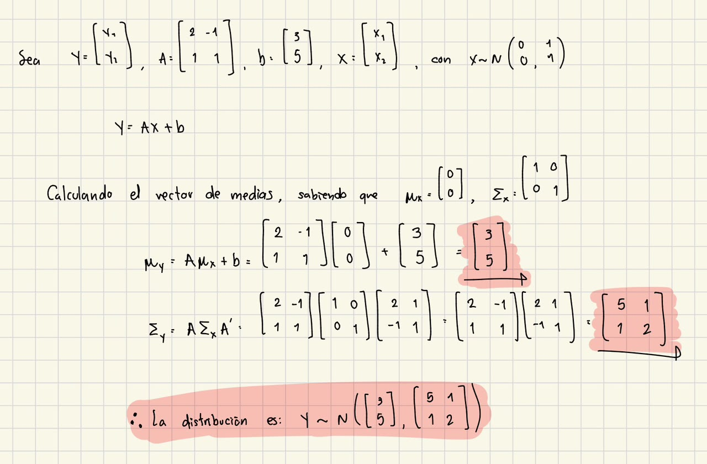
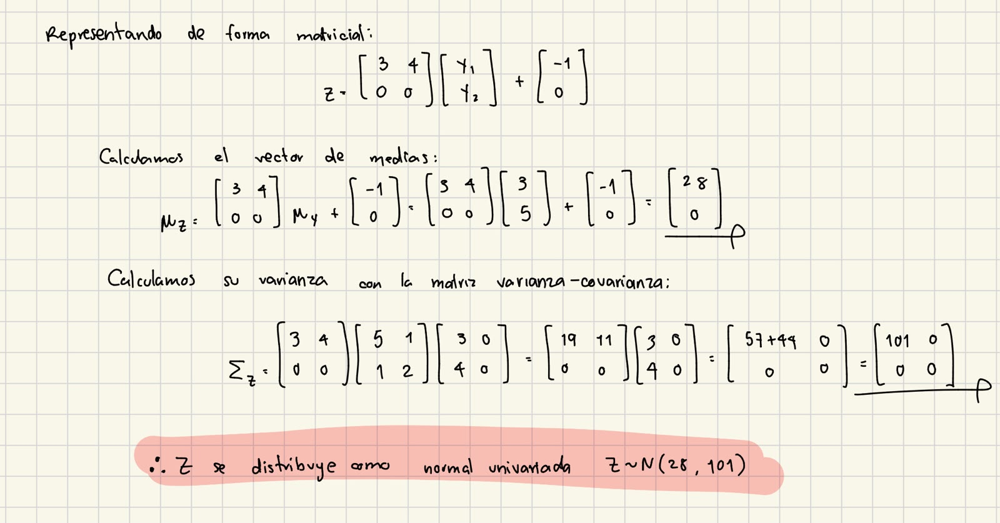

```{r setup, include=FALSE}
knitr::opts_chunk$set(echo = TRUE)
library(mnormt)
library(MVN)
```

# Actividad 1.5 La Normal Multivariada

## Problema 1

Hallar el procedimiento para el cálculo de probabilidad de que $P(X_1 \leq  3, X_2 \leq 2)$ con $X_1, X_2$ se distribuyen Normal con $\mu = (\mu_1 = 2.5, \mu_2 = 4)$ y $\Sigma = \begin{bmatrix}
1.2 & 0 \\
0 & 2.3
\end{bmatrix}$

```{r}
miu <- c(2.5, 4)
sigma <- matrix(c(1.2, 0,
                  0, 2.3), ncol = 2, byrow = TRUE)

x <- c(3, 2)

pmnorm(x, miu, sigma)
```

```{r}
# Comprobando solución debido a que las variables no están correlacionadas :)
pnorm(3, 2.5, sqrt(1.2)) * pnorm(2, 4, sqrt(2.3))
```

## Problema 2

Grafique la anterior distribución bivariada del problema 1

```{r}
x1 <- seq(2.5 - 3 * sqrt(1.2), 2.5 + 3 * sqrt(1.2), 0.1) 
x2 <- seq(4 - 3 * sqrt(2.3), 4 + 3 * sqrt(2.3), 0.1)
mu    <- c(2.5, 4)
sigma <- matrix(c(1.2, 0, 0, 2.3), nrow=2)
f     <- function(x1, x2) dmnorm(cbind(x1, x2), mu, sigma)
z     <- outer(x1, x2, f)
#create surface plot
persp(x1, x2, z, theta=-30, phi=25, expand=0.6, ticktype='detailed', col = "pink")
```

## Problema 3

Grafique los contornos de la anterior distribución normal bivariada correspondiente a las alturas de 0.01, 0.03, 0.05, 0.07, 0.09. Antes de realizar la actividad contesta: ¿A qué altura (0.01, 0.03, 0.05, 0.07, 0.09, 0.1) crees que esté el contorno con el diámetro más pequeño? ¿y el más grande?

*Pienso que al tratarse de una curva normal, en alturas cercanas a 0 el contorno será mayor; mientras que entre más alejado del 0 el diámetro de este contorno se hará más pequeño.*

```{r}
#create bivariate normal distribution
x1 <- seq(2.5 - 3 * sqrt(1.2), 2.5 + 3 * sqrt(1.2), 0.1) 
x2 <- seq(4 - 3 * sqrt(2.3), 4 + 3 * sqrt(2.3), 0.1)
mu    <- c(2.5, 4)
sigma <- matrix(c(1.2, 0, 0, 2.3), nrow=2)
f     <- function(x1, x2) dmnorm(cbind(x1, x2), mu, sigma)
z     <- outer(x1, x2, f)

#create contour plot
contour(x1, x2, z, col = "blue", levels = c(0.01,0.03, 0.05, 0.07, 0.09, 0.1))
```

*A.* *¿Cómo se relaciona el resultado del primer problema con el segundo?*

La probabilidad del Problema 1, $P(X_1 \leq 3, X_2 \leq 2) \approx 0.0633$, es el volumen bajo la superficie del Problema 2 sobre la región $(-\infty, 3] \times (-\infty, 2]$. Es decir, la gráfica muestra la función de densidad $f(x_1, x_2)$ y `pmnorm` calcula su integral sobre esa región. Como $\Sigma$ es diagonal, la covarianza es cero y, al tratarse de una normal, $X_1$ y $X_2$ son independientes, por lo que la probabilidad conjunta se factoriza como $P(X_1 \leq 3)\,P(X_2 \leq 2) = (0.676)(0.094) \approx 0.0633$. El valor es pequeño porque $x_2 = 2$ está a $1.32$ desviaciones estándar por debajo de $\mu_2 = 4$, en la cola izquierda de la superficie.

*B. ¿Cómo se relacionan los gráficos de los incisos 2 y 3?*

Los contornos del Problema 3 son cortes horizontales de la superficie del Problema 2 a una altura fija, proyectados sobre el plano $(x_1, x_2)$. Cada curva une los puntos con la misma densidad, igual que las curvas de nivel de un mapa topográfico. Los contornos son elipses centradas en $\mu = (2.5, 4)$, que corresponde al pico de la superficie. Sus ejes son paralelos a los ejes coordenados porque la covarianza es cero, y son más alargadas en la dirección de $x_2$ porque $\sigma_2^2 = 2.3 > \sigma_1^2 = 1.2$. El contorno de altura $0.1$ no aparece porque la altura máxima de la superficie es $\frac{1}{2\pi\sqrt{|\Sigma|}} \approx 0.0958$, así que ese corte no intersecta la superficie y el contorno más pequeño es el de $0.09$. Esto confirma la predicción de que el diámetro disminuye conforme aumenta la altura.

*C. ¿Cómo se relaciona la altura del contorno (pregunta 3) con el porcentaje de datos que abarcaría el contorno?*

La altura del contorno determina el límite de densidad constante. Al bajar esa altura, la elipse del contorno se expande, incrementando el volumen (porcentaje de datos) encerrado. El porcentaje exacto contenido dentro de un contorno se calcula evaluando la ecuación de la elipse (Distancia de Mahalanobis) en la función de distribución acumulada Ji-cuadrada ($\chi^2$) con 2 grados de libertad, debido a que es bivariada.

## Problema 4

Las variables $X_1$ y $X_2$ son conjuntamente normales e independientes con distribución univariada $N(0,1)$. Dadas las combinaciones lineales:

$$
Y_1 = 3 + 2X_1- X_2 \\ \\ Y_2 = 5 + X_1 + X_2
$$

1.  Encuentra la función de densidad bivariante de $Y_1$y $Y_2$ (distribución, vector de medias, matriz de varianza y covarianza)

    

    ```{r}
    miu_x <- c(0, 0)
    sigma_x <- matrix(c(1, 0,
                      0, 1), ncol = 2, byrow = TRUE)

    # Y = AX + b
    A <- matrix(c(2, -1, 
                  1, 1), nrow = 2, byrow = TRUE)
    b <- c(3, 5)

    miu_y <- A %*% miu_x + b
    sigma_y <- A %*% sigma_x %*% t(A)

    cat("Vector de medias de Y (mu_Y):\n")
    print(miu_y)
    cat("\nMatriz de Varianza-Covarianza de Y (Sigma_Y):\n")
    print(sigma_y)
    ```

2.  ¿Cómo se distribuye la variable $Z = 3Y_1 + 4Y_2 - 1$?

    

    ```{r}
    c <- matrix(c(3, 4,
                      0, 0), ncol = 2, byrow = TRUE)
    d_const <- c(-1, 0)

     
    miu_z <- c %*% miu_y + d_const
    var_z <- c %*% sigma_y %*% t(c)

    cat("Media de Z:", miu_z[1], "\n")
    cat("Varianza de Z:", var_z[1], "\n")
    ```

    La variable $Z$ se distribuye como una normal univariada con media $28$ y varianza $101$, es decir, $Z \sim N(28, 101)$.

## Problema 5

Aplique una prueba de normaldad bivariada a los siguientes datos para un nivel de significación de $0.05$

```{r}
M = read.csv("../../data/datos-A2.csv")

p = 2        #indica que se trata de dos variables
# Vector de medias
X = colMeans(M)
#Matriz de covarianza
S = cov(M)
#Distancia de Mahalanobis
d2M =  mahalanobis(M,X,S)

#Multinormalidad Test gráfico Q-Q Plot
plot(qchisq(((1:nrow(M)) - 1/2)/nrow(M),df=p),sort( d2M ) )
abline(a=0, b=1,col="red")

## Test de Multinomalidad: Método Sesgo y kurtosis de Mardia
mvn(M,subset = NULL, mvn = "mardia")
```

1.  *Interpreta el gráfico de QQ-Plot. Indica: ¿qué semejanzas hay entre este gráfico y el caso univariado? ¿qué diferencias?*

    En ambos gráficos, el objetivo visual es validar si los datos provienen de una distribución teórica específica comparando los cuantiles empíricos contra los teóricos. En este caso, si los datos cumplen el supuesto, los puntos se alinearán estrechamente sobre la recta de referencia de 45 grados (línea roja). Además, en ambos métodos, las desviaciones bruscas respecto a la línea en la parte superior derecha sirven para identificar la presencia de valores atípicos. La principal diferencia radica en la distribución teórica de contraste y la métrica graficada. En el caso univariado, se grafica el valor estandarizado de una sola variable contra los cuantiles de una distribución Normal ($Z$). En este gráfico multivariado, el eje vertical evalúa la información conjunta de ambas variables usando su Distancia de Mahalanobis al cuadrado **(**$D^2$), y el eje horizontal compara esos valores contra los cuantiles teóricos de una distribución Ji-cuadrada **(**$\chi^2$) con $p=2$ grados de libertad.

2.  Interpreta los valores p de los resultados correspondientes a Mardia Skewness y Mardia Kurtosis. Recuerde que para el caso de Normalidad Ho: Los datos se distribuyen normalmente, H1: Los datos no se distribuyen normalmente. Observa las significancias univariadas y multivariadas.

    Al ejecutar la prueba de Mardia, se obtuvo un valor p de 0.380 para el sesgo (Skewness) y un valor p de 0.268 para la curtosis. Como ambos valores son mayores al nivel de significancia $\alpha = 0.05$, no se rechaza la hipótesis nula ($H_0$), lo que indica que el conjunto de datos sí presenta normalidad multivariada.

    Al revisar la tabla de pruebas univariadas generada por la función `mvn()`, las variables individuales arrojaron valores p de 0.002 y 0.726. Esto significa que a nivel individual la variable X no cumple el supuesto de normalidad, mientas que Y si cumple con el supuesto de normalidad.

3.  Concluye sobre la normalidad multivariada de la matriz X y la normalidad univariada de cada una de las variables que componen la matriz X.

    A partir del análisis gráfico y estadístico, se concluye que una de las variables de la matriz $X$ sí cumple con el supuesto de normalidad univariada. Por su parte, la evaluación conjunta mediante la Distancia de Mahalanobis frente a la distribución $\chi^2$ y los resultados formales de las pruebas de sesgo y curtosis de Mardia dictaminan que la matriz $X$ sí se distribuye como una normal bivariada. Esto reafirma el principio estadístico de que el comportamiento de las variables individuales en este caso no fue congruente con la estructura de dispersión conjunta necesaria para la normalidad multivariada.

# Declaratoria de uso de IA durante el desarrollo de trabajo

No se utilizó IA. Declaro que durante la elaboración de esta actividad de aprendizaje para evaluar no utilicé herramientas de Inteligencia Artificial generativa.
