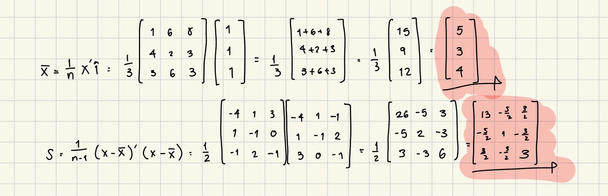
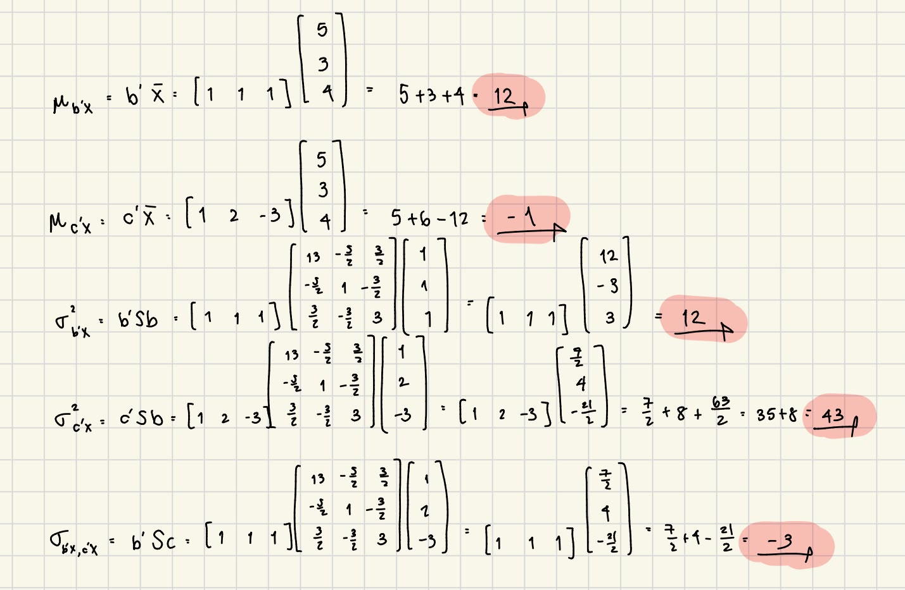
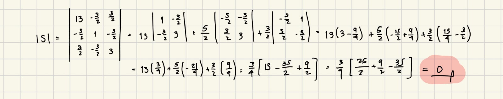
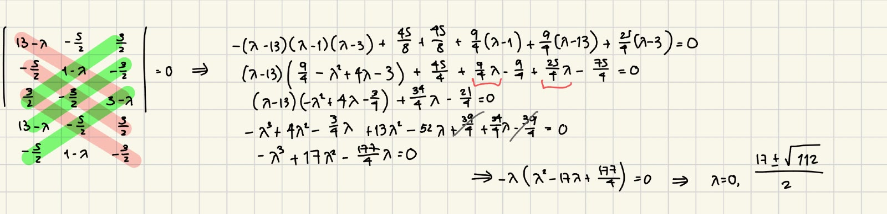

```{r setup, include=FALSE}
knitr::opts_chunk$set(echo = TRUE)
```

# Actividad 1.6 Combinaciones lineales y Validación de la Normal Multivariada

## Problema 1

Considere la matriz de datos siguiente $X = \begin{bmatrix}1 & 4 & 3 \\ 6 & 2 & 6 \\ 8 & 3 & 3\end{bmatrix}$ que consta de 3 observaciones (filas) y 3 variables (columnas)

$$
b'X = \begin{bmatrix}1 & 1 & 1\end{bmatrix} \begin{bmatrix}X_1 \\ X_2 \\ X_3\end{bmatrix} = X_1 + X_2 + X_3 \\ c'X = \begin{bmatrix}1 & 2 & -3\end{bmatrix} \begin{bmatrix}X_1 \\ X_2 \\ X_3\end{bmatrix} = X_1 + 2X_2 - 3X_3
$$

*a) Hallar la media, varianza y covarianza de X*



```{r}
t(c_vec) %*% S_X %*%  c_vec
```

```{r}
X <- matrix(c(1, 4, 3,
              6, 2, 6,
              8, 3, 3), ncol = 3, byrow = TRUE)

colnames(X) <- c("X1", "X2", "X3")

X_bar<- colMeans(X)
S_X <- cov(X)

cat("Vector de medias: \n")
X_bar
cat("\nMatriz de Varianza-Covarianza: \n")
S_X

```

El vector de medias es $\bar{x} = (5, 3, 4)'$. En la diagonal de $S$ están las varianzas ($13$, $1$ y $3$) y fuera de la diagonal las covarianzas.

*b) Hallar la media, varianza y covarianza de* $b'X$ *y* $c'X$

De las combinaciones lineales sabemos que $b = \begin{bmatrix}1 \\ 1 \\ 1\end{bmatrix}$ y $c = \begin{bmatrix}1 \\ 2 \\ -3\end{bmatrix}$.

Además sabemos que:

$$
\mu_{b'X} = b'\bar{X} \quad \mu_{c'X} = c'\bar{X} \\
\sigma^2_{b'X} = b'Sb \quad \sigma^2_{c'X} = c'Sc \quad \sigma_{b'X,c'X} = b'Sc
$$



```{r}
# Se nombran b_vec y c_vec para no sobrescribir la función c() de R
b_vec <- c(1, 1, 1)
c_vec <- c(1, 2, -3)

miu_bx <- t(b_vec) %*% X_bar
miu_cx <- t(c_vec) %*% X_bar

var_bx <- t(b_vec) %*% S_X %*% b_vec
var_cx <- t(c_vec) %*% S_X %*% c_vec
cov_bc <- t(b_vec) %*% S_X %*% c_vec

cat("Media de b'X: \n")
miu_bx

cat("\nVarianza de b'X: \n")
var_bx

cat("\nMedia de c'X: \n")
miu_cx

cat("\nVarianza de c'X: \n")
var_cx

cat("\nCovarianza entre b'X c'X: \n")
cov_bc

```

*c) Hallar el determinante de S (matriz de var-covarianzas de X)*



```{r}
S_gen <- det(S_X)
S_gen
```

*d) Hallar los valores y vectores propios de S*



```{r}
eigen_S <- eigen(S_X)

cat("Valores propios (Eigenvalues):\n")
eigen_S$values

cat("\nVectores propios (Eigenvectors):\n")
eigen_S$vectors

```

*e) Argumentar si hay independencia entre **b'X** y **c'X** , ¿y qué ocurre con X1, X2 y X3? ¿son independientes?*

Como $b'Sc$ es distinto de 0, se comprueba que no hay independencia entre estas 2 combinaciones lineales y están correlacionadas. Por otra parte, en las variables de X, observamos que todas las covarianzas son distintas a 0, por lo que no son independientes e incluso se nota una gran correlación entre $X_2$ y $X_3$.

```{r}
cor(X)
```

f)  Hallar la varianza generalizada de S. Explicar el comportamiento de los datos de X basándose en la varianza generalizada, en los valores y vectores propios de S. 

```{r}
var_gen <- det(S_X)
var_gen

sum(diag(S_X))                                # traza

X %*% eigen_S$vectors[,3]                     # combinación asociada al valor propio 0
X %*% c(1, 7, 3)                              # X1 + 7*X2 + 3*X3
```

El valor nulo indica que los datos no están ocupando un volumen dentro del espacio de 3 variables. Esto se puede notar debido a que un eigenvalor es muy cercano a 0 y que al multiplicar su eigenvector correspondiente a la matriz de datos, nos devuelve el mismo valor en cada fila. Podemos decir que existe dependencia lineal entre las variables. Esto se puede notar debido a que un eigenvalor es muy cercano a 0 y que al multiplicar su eigenvector correspondiente a la matriz de datos, nos devuelve el mismo valor en cada fila ( $- 38/\sqrt{59} \approx  -4.95$). Es decir, $X_1 + 7X_2 + 3X_3 = 38$ en las tres observaciones, por lo que existe dependencia lineal exacta entre las variables y los datos viven en un plano (rango 2) dentro de $\mathbb{R}^3$.

## Problema 2

Explore los resultados del siguiente código y dé una interpretación (se sugiere intersertarlo en un trozo de R en Rmarkdown para que dé varias ventanas de salida de resutados):

```{r}
library(MVN)
set.seed(123)
x = rnorm(100, 10, 2)
y = rnorm(100, 10, 2)
datos = data.frame(x,y)
# Prueba de Henze-Zirkler con mvn()
resultado <- mvn(datos, mvn_test = "hz")
plot(resultado, type = "persp")
plot(resultado, type = "contour")
```

```{r}
resultado
```

Los valores obtenidos en la prueba de normalidad multivariada presenta un p-valor mayor a 0.05, por lo que no rechazamos $H_0$ y podemos decir que no hay evidencia estadística contra la normalidad bivariada, lo que hace sentido al crear ambas variables como una distribución normal. Aunado a esto, las pruebas de normalidad univariada también ocurre lo msimo, no se rechaza normalidad.

Podemos observar que las medias de las variables se encuentran dentro del error estándar, manteniendose cerca del 10; mientras que las desviaciones estandándar son menores a 2 (planteada en la distribución rnorm). En $x$ podemos observar un sesgo y curtosis relativamente baja, por lo que podría considerarse prácticamente normal; mientras que en $y$ existe una cola derecha moderada, pero sin rechazar la normalidad.

Los gráficos de densidad estimada muestran una distribución unimodal, con contornos aproximadamente elípticos y concentrados en una sola región, consistente con una distribución normal bivariada. Se aprecia una ligera cola hacia valores altos de y, congruente con su asimetría muestral (0.64), sin que esto altere la conclusión de las pruebas de normalidad (HZ = 0.452, p = 0.705; Anderson-Darling con p \> 0.05 en ambas variables). Por lo tanto, no hay evidencia para rechazar la normalidad multivariada de los datos.

## Problema 3

Un periódico matutino enumera los siguientes precios de autos usados para un compacto extranjero con edad medida en años y precio en venta medido en miles de dólares. 

$x_1: [1, 2, 3, 3, 4, 5, 6, 8, 9, 11]$

$x_2: [18.95, 19.00, 17.95, 15.54, 14.00, 12.95, 8.94, 7.49, 6.00, 3.99]$

*a) Construya un diagrama de dispersión*

```{r}
x1 <- c(1, 2, 3, 3, 4, 5, 6, 8, 9, 11)
x2 <- c(18.95, 19.00, 17.95, 15.54, 14.00, 12.95, 8.94, 7.49, 6.00, 3.99)


X <- cbind(x1, x2)             # matriz n x p
n <- nrow(X)
p <- ncol(X)

plot(x1, x2, pch = 19, xlab = "Edad (años)", ylab = "Precio (miles de USD)",
     main = "Autos usados: precio vs. edad")
```

*b) Inferir el signo de la covarianza muestral a partir del gráfico.*

A partir del diagrama de dispersión de la muestra de datos, podemos inferir que la covarianza de esta muestra es negativa: a mayor edad del auto, menor es su precio, con una tendencia lineal decreciente muy marcada.

```{r}
xbar <- colMeans(X)
S    <- cov(X)
xbar; S; cor(x1, x2)
```

Lo mismo en forma matricial:

```{r}
uno  <- matrix(1, nrow = n, ncol = 1)
xbar <- t(X) %*% uno / n
Xc   <- X - uno %*% t(xbar)
S    <- t(Xc) %*% Xc / (n - 1)
D    <- diag(1 / sqrt(diag(S)))
R    <- D %*% S %*% D

cat("Vector de medias: \n")
xbar
cat("\nMatriz de varianza-covarianza: \n")
S
cat("\nMatriz de correlación: \n")
R
cat("\nCovarianza s_{12}: \n")
S[1, 2]
```

La covarianza es $s_{12} = -17.71 < 0$ y la correlación es $r = -0.978$, lo que confirma lo observado en el gráfico.

*c) Calcular el cuadrado de las distancias de Mahalanobis* $(x_j - \bar{x})' S ^{-1} (x_j - \bar{x})$ *con* $x_j '= [x_{j1}, x_{j2}]$

```{r}
Sinv <- solve(S)
d2   <- diag(Xc %*% Sinv %*% t(Xc))
round(d2, 3)
sum(d2)           
```

Los valores de $d_j^2$ van de $0.018$ a $4.215$ y su suma es $18 = (n-1)p$, como corresponde cuando $S$ se calcula con divisor $n-1$.

*d) Usando las anteriores distancias, determine la proporción de las observaciones que caen dentro del contorno de probabilidad estimado del 50% de una distribución normal bivariada.*

```{r}
c50 <- qchisq(0.50, df = p)  
c50
dentro <- d2 <= c50
sum(dentro); mean(dentro)                   
```

El contorno del 50% corresponde a $d^2 \leq \chi^2_2(0.50) = 1.386$. Quedan dentro 5 de las 10 observaciones, es decir, una proporción de $0.5$, que coincide con lo esperado para una normal bivariada.

*e) Ordene el cuadrado de las distancias del inciso c y construya un diagrama chi-cuadrado*

```{r}
d2_ord <- sort(d2)
q <- qchisq((1:n - 0.5) / n, df = p)
cbind(j = 1:n, d2_ord = round(d2_ord, 3), q = round(q, 3))

plot(q, d2_ord, pch = 19,
     xlab = "Cuantiles chi-cuadrado (2 g.l.)",
     ylab = "Distancias de Mahalanobis ordenadas",
     main = "Diagrama chi-cuadrado")
abline(0, 1, col = "red")
cor(q, d2_ord)   
```

Los puntos siguen aproximadamente la recta de 45° y la correlación entre las distancias ordenadas y los cuantiles chi-cuadrado es de $0.964$. El punto más alto ($4.215$ frente a $5.991$ esperado) queda por debajo de la recta, pero no se observan valores atípicos.

*f) Dados los resultados anteriores, serían argumentos para decir que son aproximadamente normales bivariados?*

Sí, hay argumentos a favor de una normalidad bivariada aproximada: el $50\%$ de las observaciones cae dentro del contorno del $50\%$, igual a lo esperado, y el diagrama chi-cuadrado es casi lineal ($r = 0.964$), sin puntos atípicos.

Sin embargo, hay que tener cautela: con $n = 10$ observaciones la proporción del inciso d) y los puntos del diagrama tienen mucha variabilidad, y las distancias usan $\bar{x}$ y $S$ estimados, por lo que la aproximación chi-cuadrado es solo aproximada. Además, la relación edad-precio de autos suele ser algo curva, y esto pudo notarse en el diagrama de dispersión. En conclusión, no hay evidencia clara contra la normalidad bivariada y los resultados son compatibles con ella, pero con una muestra tan pequeña no se puede afirmar con firmeza.

# Declaratoria de uso de IA durante el desarrollo de trabajo

No se utilizó IA. Declaro que durante la elaboración de esta actividad de aprendizaje para evaluar no utilicé herramientas de Inteligencia Artificial generativa.
